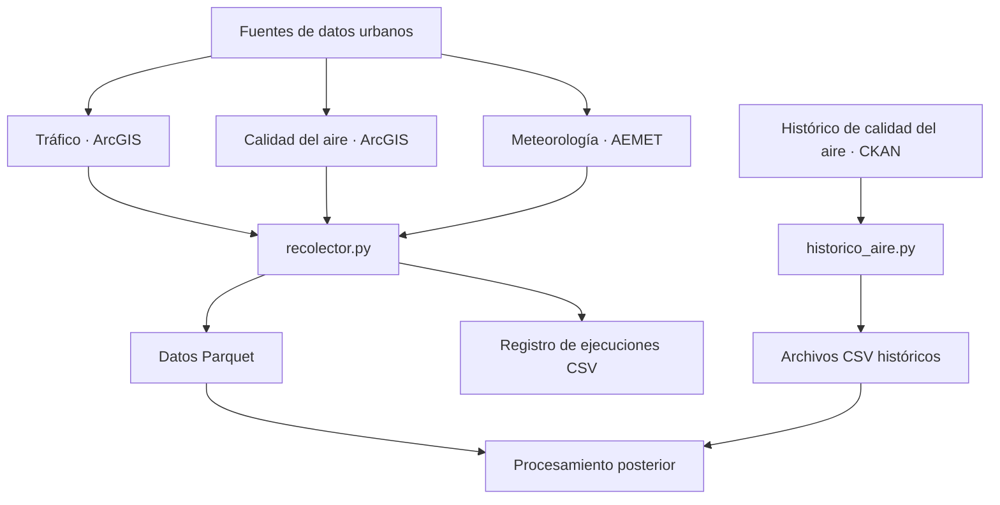

# Proyecto 4 · Urbano

## Descripción y objetivo

Este repositorio corresponde al Proyecto 4 del módulo de Big Data, relacionado con la ingesta de datos abiertos urbanos de Valencia.

El proyecto trabaja con datos de tráfico, calidad del aire y meteorología. Para ello, se prepara un recolector que obtiene periódicamente datos de las fuentes disponibles y los almacena para su posterior procesamiento.

## Arquitectura



El recolector consulta las fuentes de tráfico y calidad del aire disponibles en ArcGIS y almacena los resultados en archivos Parquet, organizados por fecha de captura.

El histórico de calidad del aire se descarga mediante un script independiente y se guarda en formato CSV.

La conexión con AEMET está pendiente de completar. (solicité la API Key pero no me llega)

## Estructura del repositorio

```text
bigdata-p4-urbano/
├── dashboard/
├── data/
│   └── raw/
│       ├── trafico/
│       ├── aire/
│       ├── historico_aire/
│       └── _registro/
├── evidencias/
│   └── programador_tareas/
│       ├── tarea_configurada.png
│       └── tarea_ejecucion.png
├── etl/
├── ingesta/
│   └── historico_aire.py
├── logs/
├── nifi/
├── recolector/
│   └── recolector.py
├── .env
├── .gitignore
├── ejecutar_recolector.bat
└── README.md
```

Los datos descargados, las credenciales y los archivos generados durante la ejecución están excluidos del repositorio mediante `.gitignore`.

## Recolector de datos urbanos

El archivo `recolector/recolector.py` permite consultar las fuentes de tráfico y calidad del aire de Valencia.

Las consultas se realizan mediante peticiones a los servicios ArcGIS, utilizando paginación para recuperar los registros disponibles.

El recolector permite seleccionar qué fuente consultar:

```powershell
python .\recolector\recolector.py --fuente trafico
python .\recolector\recolector.py --fuente aire
python .\recolector\recolector.py --fuente todas
```

Los datos se almacenan en formato Parquet, organizados en carpetas según la fecha de captura:

```text
data/raw/
├── trafico/
│   └── fecha=AAAA-MM-DD/
├── aire/
│   └── fecha=AAAA-MM-DD/
└── _registro/
    └── ejecuciones.csv
```

Cada registro incluye el campo `captura_utc`, que identifica el momento de la captura. Además, se mantiene un CSV con el resultado de las ejecuciones, la fuente consultada, el número de registros y los posibles errores.

## Histórico de calidad del aire

El archivo `ingesta/historico_aire.py` permite descargar los datos históricos de calidad del aire desde la API CKAN de datos abiertos de Valencia.

El script contempla dos recursos históricos:

- **2016–2021:** descargado correctamente, con 449.026 registros.
- **2021–2022:** pendiente de configurar el identificador del recurso CKAN.

Los datos se almacenan en CSV dentro de `data/raw/historico_aire/`.

Durante la descarga se normalizan los nombres de las columnas, manteniendo los valores originales de los registros.

El script permite utilizar el argumento `--forzar` para volver a descargar los archivos existentes:

```powershell
python .\ingesta\historico_aire.py
python .\ingesta\historico_aire.py --forzar
```

Por defecto, si el archivo ya existe, se omite la descarga.

## Programación automática

El recolector está preparado para ejecutarse periódicamente mediante el Programador de tareas de Windows.

La tarea `Recolector P4 - Datos urbanos` está configurada para ejecutarse cada hora.

Para facilitar su ejecución se utiliza el archivo:

```text
ejecutar_recolector.bat
```

Este archivo activa el intérprete de Python del entorno virtual y ejecuta el recolector para todas las fuentes implementadas.

En la carpeta `evidencias/programador_tareas/` se incluyen capturas de:

- La configuración de la tarea programada.
- Una ejecución registrada en el historial del Programador de tareas.

## Configuración y dependencias

El entorno utiliza Python y las siguientes librerías:

- `requests`
- `pyarrow`
- `python-dotenv`

La clave de acceso de AEMET debe configurarse mediante la variable de entorno `AEMET_API_KEY` en el archivo `.env`.

El archivo `.env` no se incluye en Git para evitar versionar credenciales.

## Estado actual

- [x] Repositorio Git inicializado en la rama `main`.
- [x] Estructura inicial de carpetas creada.
- [x] Archivo `.gitignore` configurado.
- [x] Recolector de tráfico implementado y probado.
- [x] Recolector de calidad del aire implementado y probado.
- [x] Descarga paginada de datos ArcGIS.
- [x] Almacenamiento de las capturas en formato Parquet.
- [x] Registro de ejecuciones en CSV.
- [x] Programación automática cada hora mediante el Programador de tareas de Windows.
- [x] Capturas de evidencia de la tarea programada y de su ejecución.
- [x] Script de descarga del histórico de calidad del aire.
- [x] Descarga del recurso histórico 2016–2021 (449.026 registros).
- [x] Normalización de los nombres de las columnas del histórico.
