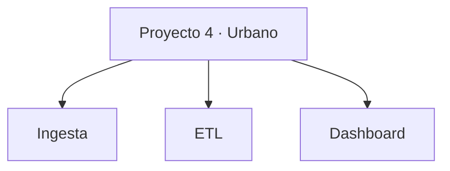

# Proyecto 4 · Urbano

## Descripción y objetivo

Este repositorio corresponde al Proyecto 4 del módulo de Big Data.

El proyecto está relacionado con el uso de datos urbanos abiertos mediante la plataforma FIWARE, dentro del trabajo con datos de tráfico y calidad del aire del módulo.

## Arquitectura



El diagrama muestra la estructura inicial del repositorio y sirve como referencia para organizar sus distintos componentes. Esta estructura podrá evolucionar a medida que se desarrolle el proyecto.

## Estructura del repositorio

```text
bigdata-p4-urbano/
├── ingesta/
├── etl/
├── dashboard/
├── .gitignore
└── README.md
```

## Entorno de trabajo

El repositorio cuenta con una estructura inicial preparada para organizar los componentes del proyecto.

## Estado actual

- [x] Repositorio Git inicializado en la rama `main`.
- [x] Carpetas iniciales creadas.
- [x] Archivo `.gitignore` creado.
- [x] Archivo `README.md` creado.
- [ ] Desarrollo de los componentes del proyecto.
